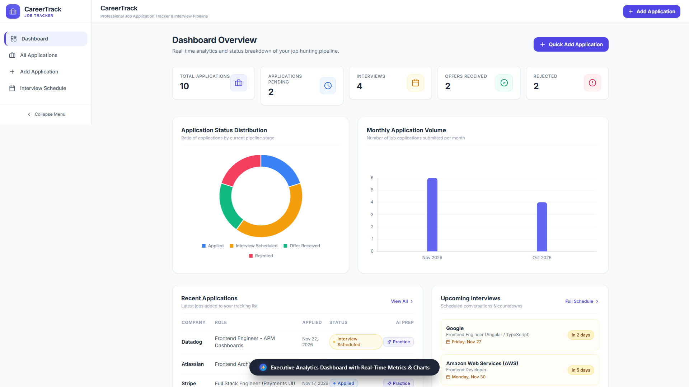

# CareerTrack – Job Application Tracker

CareerTrack is a full-stack, SaaS-inspired **Job Application Tracking System** engineered to help developers and job seekers organize, monitor, and visualize their job search pipeline. Built with **Angular 17**, **Node.js/Express**, and **MongoDB / Mongoose**, it provides full CRUD capabilities, interactive Chart.js analytics, dynamic Kanban and Table views, interview schedule countdowns, and reactive form validation.

This project is specifically structured to be clean, modular, and beginner-friendly, while serving as an interview preparation reference for modern Angular architecture.

---

## Table of Contents

1. [Project Overview](#project-overview)
2. [Application Demo](#application-demo)
3. [Key Features](#key-features)
4. [Technology Stack](#technology-stack)
5. [Architecture & System Flow](#architecture--system-flow)
6. [Installation & Setup](#installation--setup)

---

## 1. Project Overview

When transitioning from React/MERN to Angular, developers often look for an intuitive demonstration of Angular's core mechanics: Standalone Components, Dependency Injection, RxJS Observables, Reactive Forms, and the modern `@if` / `@for` template control flow.

CareerTrack bridges this gap by delivering a practical, production-ready full-stack application that manages job applications through their complete lifecycle:
**Applied $\rightarrow$ Interview Scheduled $\rightarrow$ Offer Received / Rejected**.

---

## 2. Application Demo

Explore CareerTrack's interactive job tracking dashboard, application management, dynamic Kanban pipeline, and AI-powered interview preparation powered by Google Gemini:


🎬 **[Watch Full High-Definition Demo Video (MP4)](docs/demo.mp4)**

*Dashboard Preview:*


---

## 3. Key Features

- **Executive Analytics Dashboard:**
  - Real-time stat cards: Total Applications, Applications Pending, Interviews Scheduled, Offers Received, and Rejected.
  - Interactive **Chart.js Donut Chart** visualizing application status breakdown.
  - Interactive **Chart.js Bar Chart** tracking monthly application volume.
  - Quick summary tables of recent job applications and upcoming interviews.

- **Dual-View Application Management:**
  - **Table View:** Clean, sortable tabular display with badges, direct status dropdown switcher, external job posting links, and edit/delete actions.
  - **Kanban Board View:** Four status columns (`Applied`, `Interview Scheduled`, `Offer Received`, `Rejected`). Users can update status directly from card dropdowns with instant optimistic UI updates.

- **Reactive Form Validation:**
  - Unified, reusable form for both **Add Application** and **Edit Application**.
  - Dynamic validation rules (minimum characters, required applied date, URL pattern matching for job links).
  - Inline error feedback messages triggered by user interaction.

- **Chronological Interview Schedule:**
  - Automatic countdown badges (`Today!`, `Tomorrow`, `In X days`).
  - Chronological sorting of upcoming interviews.
  - Dedicated past interviews review section.
  - Notes for technical interview preparation, recruiter names, and talking points.

- **AI-Powered Interview Preparation (Google Gemini API):**
  - Instant role-tailored questions generation based on company, role, experience level, and job description.
  - STAR-method sample answers, key concepts to remember, revision topics, and strategy tips.
  - Interactive preparation progress bar, category filters, and mark-as-practiced checkboxes.

- **User Experience (UX) Enhancements:**
  - Responsive collapsible sidebar navigation (desktop collapse + mobile drawer).
  - Floating toast notification system (success, error, warning, info) with auto-dismiss.
  - Delete confirmation modal preventing accidental data loss.
  - Meaningful empty states with actionable shortcuts.

---

## 4. Technology Stack

### Frontend
- **Framework:** Angular 17 (Standalone Components architecture)
- **Language:** TypeScript 5.4+
- **Styling:** Tailwind CSS 3.4
- **Charts:** Chart.js 4.4 (integrated via native HTML5 Canvas & `@ViewChild`)
- **Routing:** Angular Router (Lazy-loaded standalone routes via `loadComponent`)
- **Forms:** Angular Reactive Forms (`FormBuilder`, `FormGroup`, `Validators`)
- **HTTP Client:** Angular `HttpClient` + RxJS Observables
- **Icons:** Custom SVG component based on Lucide Icon specifications

### Backend
- **Runtime:** Node.js (v18+ / v20+ / v22+)
- **Framework:** Express.js 4.19
- **Database & ODM:** MongoDB & Mongoose 8.3 (with file-backed fallback store)
- **AI SDK:** Official Google Gemini SDK (`@google/genai`)
- **Configuration:** `dotenv`
- **Cross-Origin Sharing:** `cors`

---

## 5. Architecture & System Flow

```
+-------------------------------------------------------------------------------+
|                             CareerTrack Client                                |
|                                (Angular 17)                                   |
|                                                                               |
|  [ Dashboard ]      [ All Applications ]    [ Add/Edit Form ]   [ Interviews ]|
|  - Stat Cards       - Table View            - Reactive Forms    - Countdown   |
|  - Chart.js Donut   - Kanban Board View     - Custom Validators - Action Links|
|  - Chart.js Bar     - Status Dropdown       - Shared Component  - AI Prep     |
+---------------------------------------+---------------------------------------+
                                        |
                         RxJS Observables / HTTP Client
                                        |
                                        v
+-------------------------------------------------------------------------------+
|                             CareerTrack Server                                |
|                           (Express.js REST API)                               |
|                                                                               |
|  [ Routes ]           [ Controllers ]              [ AI Service ]             |
|  - /api/jobs          - getJobs (search/filter)    - Google Gemini Flash SDK  |
|  - /api/jobs/:id      - createJob / updateJob      - STAR Answers Generator   |
|  - /api/jobs/stats    - deleteJob / getStats       - Structured JSON schema   |
|  - /api/ai/interview  - Centralized Error Handler  - CORS & Middleware        |
+---------------------------------------+---------------------------------------+
                                        |
                        Mongoose ODM / File Fallback
                                        |
                                        v
+-------------------------------------------------------------------------------+
|                              Persistent Layer                                 |
|                                                                               |
|   Primary: MongoDB Server (MongoDB Atlas or mongodb://localhost:27017)        |
|   Fallback: Persistent File Store (backend/data/jobs.json)                    |
+-------------------------------------------------------------------------------+
```

---

## 6. Installation & Setup

### Prerequisites
- **Node.js**: v18.0.0 or higher (`node -v`)
- **npm**: v9.0.0 or higher (`npm -v`)
- **MongoDB** (Optional, recommended): MongoDB Atlas connection URI or local MongoDB. If MongoDB is offline, the backend automatically uses its persistent JSON fallback store.

### Step 1: Install Dependencies

From the workspace root directory:

```bash
# Install backend dependencies
cd backend
npm install

# Install frontend dependencies
cd ../frontend
npm install

# Return to root
cd ..
```

### Step 2: Environment Configuration

Create a `backend/.env` file with the following variables:

```env
PORT=5000
MONGODB_URI=your_mongodb_connection_uri
GEMINI_API_KEY=your_google_gemini_api_key
GEMINI_MODEL=gemini-2.5-flash
```

### Step 3: Run the Application

#### 1. Start the Backend API Server
```bash
cd backend
npm start
```
The backend starts at: `http://localhost:5000`

#### 2. Start the Angular Frontend
In a separate terminal:
```bash
cd frontend
npm start
```
The frontend application opens at: `http://localhost:4200`

---

## License

This project is open-source and licensed under the [MIT License](LICENSE).
